# Desktop Dashboard

A macOS desktop dashboard built on [Übersicht](https://tracesof.net/uebersicht/), with a playable chess puzzle, live Lichess TV, movie and show picks, weather, git projects, system stats and network connections, plus a matching terminal theme.

Everything is plain scripts: no API keys, no paid services, no AI calls.

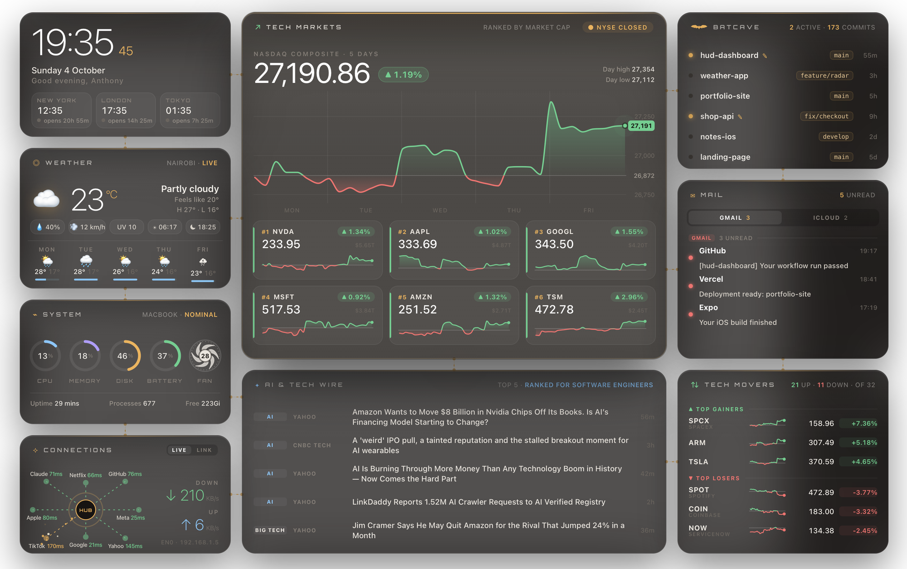

**Look and feel:** refined dark "liquid glass" panels (frosted, translucent, a soft light that follows the cursor), thin SF numerals, small Orbitron titles, one amber accent with an amber hairline across the top of each panel. `wallpaper_glass.py` generates the matching dark wallpaper. Over the widgets the cursor becomes a crosshair with a trailing targeting ring and click ripples.

**Interactive:** the panels are chained in place. Pull one by its header (or the clock from anywhere) and its chains stretch; let go and it springs back home. Click projects or shows to open them, and play the chess puzzle right on the desktop.

## Widgets

| Widget | Shows | Data source | Refresh |
|---|---|---|---|
| Clock | Time, date, New York / London / Tokyo world clocks | System clock | 1 s |
| Weather | Nairobi now + 5-day forecast | [Open-Meteo](https://open-meteo.com) | 15 min |
| System | CPU, memory, disk, battery | `top`, `memory_pressure`, `df`, `pmset` | 10 s |
| Connections | Live health of 8 services around a HUB, throughput, Wi‑Fi / VPN / speed test | Python sockets, `netstat`, CoreWLAN, `networkQuality` | 30 s |
| Chess Puzzle | Playable daily puzzle (or a fresh one), hints, solution, streak; optional Lichess login for rated puzzles | [Lichess](https://lichess.org) API | on demand |
| Batcave | Git projects in `~/Documents/GitHub` and `~/Developer` | `git` | 1 min |
| Lichess TV | The top-rated game being played right now, live | Lichess TV feed | 3 s |
| Watch | A daily movie/show pick for your taste, more picks, DC/Marvel release countdowns and new episodes | Wikipedia + Wikidata, [TVmaze](https://www.tvmaze.com/api) | 30 min |

### What each widget looks like

| | |
|---|---|
| 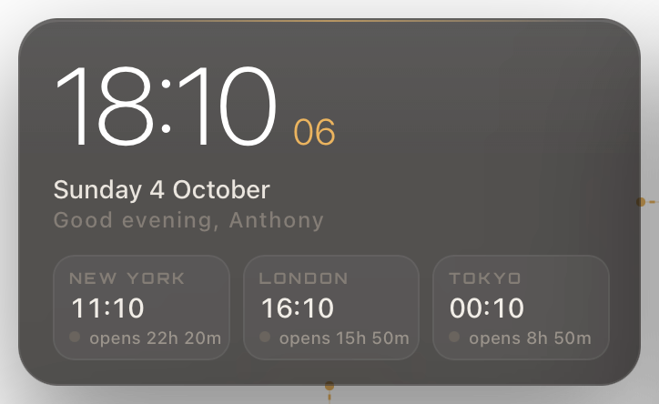 **Clock**: local time and date with New York, London and Tokyo world clocks (hover one to put it on the big display). | 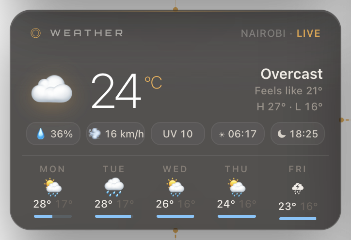 **Weather**: current conditions, feels‑like, humidity, wind, UV, sunrise/sunset and a 5‑day forecast with rain chance bars. |
| 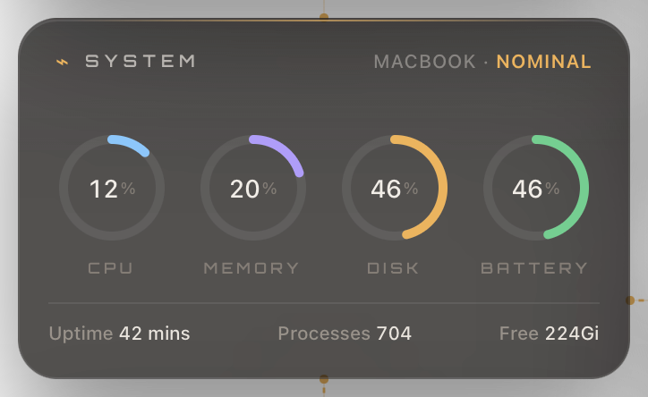 **System**: CPU, memory, disk and battery rings that turn amber above 65% and red above 85% (battery red under 20%, ⚡ while charging), and a fan that spins faster as the combined load rises (CPU counts most, then memory, battery drain and disk), from a lazy turn at idle to a blur flat out. Plus uptime, process count and free disk. | 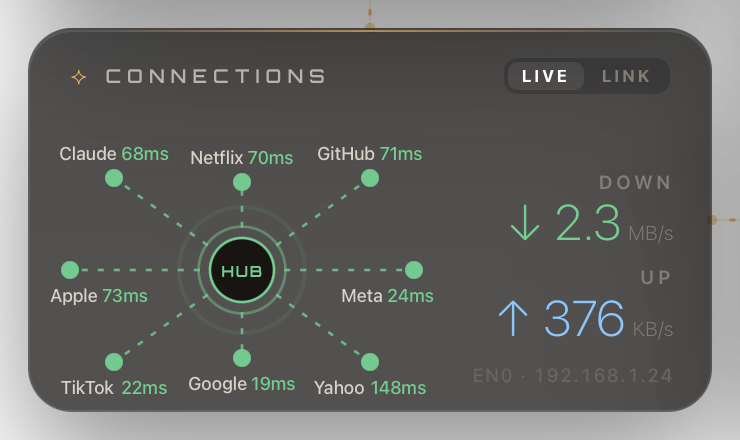 **Connections**: live health of 8 services around a HUB, plus download and upload speed. See [Connections widget](#connections-widget) for every state. |
| 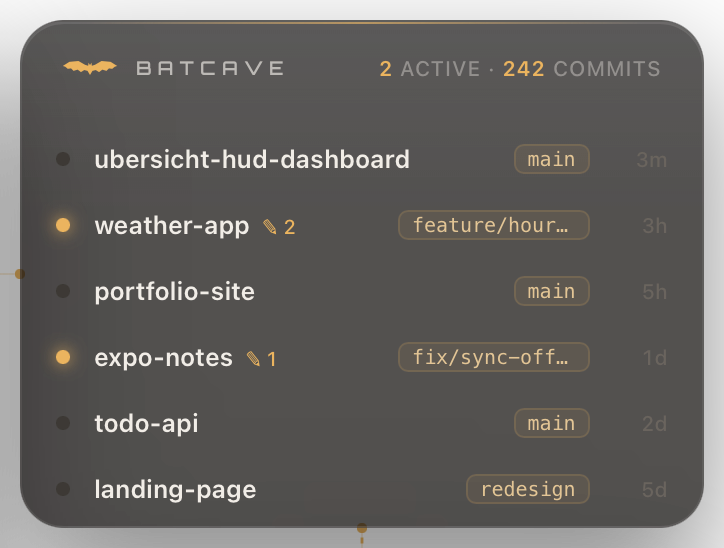 **Batcave**: your git projects, most recently committed first, with branch, uncommitted changes (✎) and the age of the last commit. Click one to open it in VS Code. | 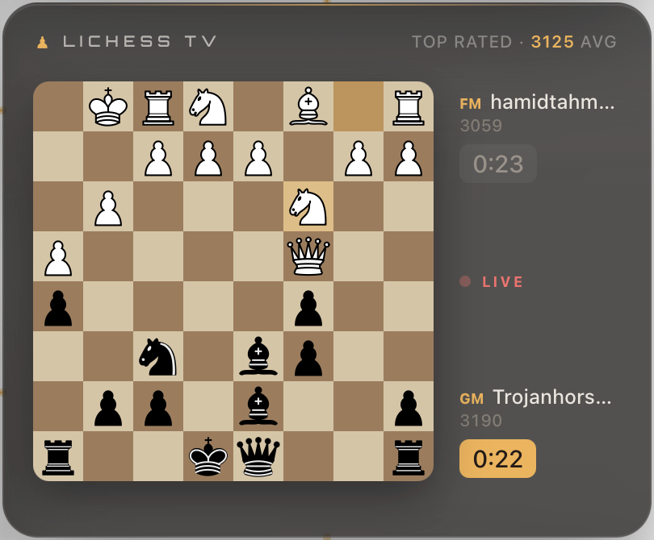 **Lichess TV**: the top-rated game on Lichess right now, move by move, with live clocks. Click the board to watch it on Lichess. |
| 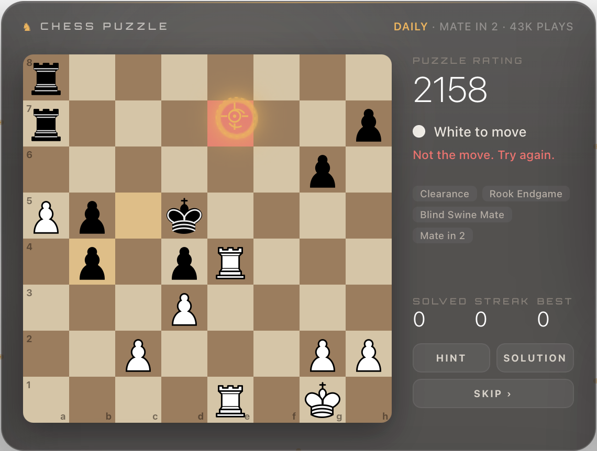 **Chess Puzzle**: Lichess's daily puzzle, playable on the desktop. Drag or click pieces (legal moves are dotted); the opponent replies by itself, a wrong move snaps back. Hint, solution, skip, and a solved count with streak. Click **Connect your Lichess account** to use a puzzle-only token (kept in the Keychain): puzzles then match your rating and count toward it on Lichess. |  **Watch**: tonight's pick from a hand-made list (Batman, Marvel, AI & tech, money & markets, mind-bending sci-fi) with a trailer button; *Seen it* / *Not for me* drop it for good. COMING UP counts down to DC / Marvel releases and new episodes. Edit `PICKS` in `picks.py` to change the list. |

Each data panel shows a red badge in its header if its data fails or stops updating (for example *No internet*).
Screenshots use placeholder projects; everything else is live data.

## Connections widget

Every 30 seconds `network.sh` times a DNS lookup + TCP connect to port 443 for each service (no page download), samples
throughput over one second, and the panel draws each service as a node wired to a central **HUB**.

| Healthy | Mild |
|---|---|
|  | 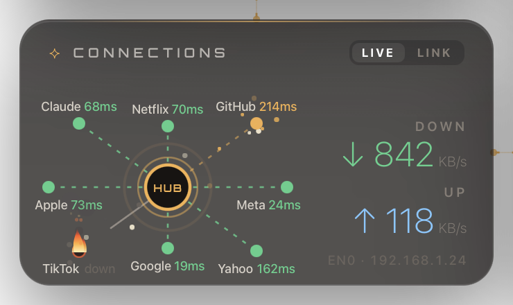 |
| Every service answers under its own limit. Lines flow green and the HUB pulses green. | A link is slow (amber, flickering, throwing sparks) and/or one service is down. A down service loses its line and burns while the HUB keeps reaching out to it. The HUB turns amber (grey if the only problem is one down service). |

| Unhealthy | Offline |
|---|---|
| 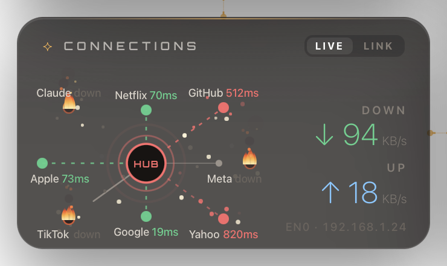 | 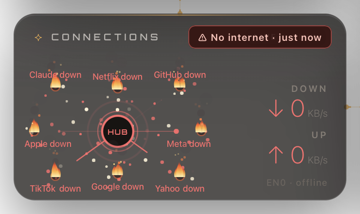 |
| Two or more services are down, or a link is past its red limit. The HUB turns red and beats faster. | Every service is down or there is no IP. The whole panel goes red with sparks everywhere and a red **No internet** badge appears in the header. |

**Colours per service:** green under the amber limit, amber up to the red limit, red above it, burning when the connection fails (3 s timeout).
The limits live in `LIMITS` in `build_widgets.py`, as `[amber from, red from]` in ms. They are tuned for Nairobi
(Meta/TikTok/Google `90/250`, Apple/Netflix/Claude/GitHub `150/400`, Lichess `300/750`, anything else `150/450`).
Measure your own normal times with `~/.stark/network.sh` and set amber to about 2× and red to about 5× those.

**Changing the services:** edit `HOSTS` in `network.sh` (`("Name", "host.com")`, up to 8). Their order is the node
position in the ring; the 7th and 8th sit top and bottom centre, so give those short names. Add a `LIMITS` entry for any
new name, then run `python3 ~/.stark/build_widgets.py`.

**Play with the nodes:** drag a service anywhere in the panel (its line stretches and dashes) and let go: it springs
home with a wobble, bouncing off the panel edges if you fling it. Click one to ping just that service (`ping.py`), and
a packet runs out along its line and back with the new time.

**LINK view** (toggle in the header): Wi‑Fi signal, channel and link rate, VPN state, public IP and ISP (from
[ipinfo.io](https://ipinfo.io), refreshed every 10 min) and the last speed test (macOS's built‑in `networkQuality`,
every 3 hours, skipped on an iPhone hotspot; ↻ runs one now). macOS hides the Wi‑Fi name from scripts, so to show it
create a **Shortcuts** shortcut named exactly `Wi-Fi Name` containing the single action *Get Network Details*
(Network Name of Wi‑Fi). Without it the panel says *Name hidden*.

**Free VPN:** the VPN row's **OFF / US / UK** switch runs `vpn.sh`, which starts Tor (`brew install tor`) with its exit
pinned to that country and turns on the macOS SOCKS proxy only after checking the exit really is there (UK exits are
double-checked against ipinfo.io). Tor runs only while the VPN is on; a switch takes about 7–15 s. Browsers and most
apps follow the system proxy; for terminal tools add `source ~/.stark/vpn.zsh` to `~/.zshrc` (also gives a `vpn us|uk|off`
alias). It's Tor, so expect slower speeds and the odd site that blocks it.

## Install

Requirements: macOS 13 or later, [Homebrew](https://brew.sh), and the Xcode Command Line Tools
(`xcode-select --install`, needed to compile the small Swift helpers `wifi` and `hudcursor`). Python 3 comes with
the Command Line Tools; no pip packages are used.


```sh
git clone https://github.com/nambiropeter/ubersicht-hud-dashboard ~/.stark
~/.stark/install.sh
```

The repo **must** live at `~/.stark` (the widgets call their scripts from there). `install.sh` installs Übersicht
(via Homebrew), compiles the Swift helpers, generates the widgets and loads the background agent (the
pointer hider). Open Übersicht once and allow it in **System Settings → Privacy & Security** if macOS asks.
To use it only for the Connections widget, delete the other `.jsx` files from
`~/Library/Application Support/Übersicht/widgets/` (they come back on the next rebuild).

Troubleshooting:
- **Panels blank:** quit and reopen Übersicht (`open -a Übersicht`).
- **Red sync badge on a panel:** its script failed or stopped updating; run it by hand (e.g. `~/.stark/network.sh`) to see the error.
- **Layout off on your screen:** the `POS` grid is laid out for a 1470×956 pt screen (13" MacBook Air); adjust it in `build_widgets.py`.
Optional terminal theme (prompt, aliases, `stocks`, `news`, `alfred`, `jarvis`):

```sh
echo 'source ~/.stark/stark.zsh' >> ~/.zshrc
```

## Customize

All widgets are generated from **`build_widgets.py`**, so edit it and run `python3 ~/.stark/build_widgets.py`.

- **Layout:** the `POS` grid at the top (laid out for a 1470×956 pt screen)
- **Weather location:** `LAT`/`LON` in `weather.sh`

## Files

```
build_widgets.py   generates all Übersicht widgets
puzzle.py          Lichess puzzle + every position and legal move along it (needs `pip3 install chess`)
picks.py           movie & show picks: Wikipedia/Wikidata details, TVmaze episodes
weather.sh         Open-Meteo forecast
system.sh          CPU / memory / disk / battery
network.sh         IP, throughput, service latency, Wi-Fi / VPN / public IP
ping.py            one-service latency probe (click a Connections node)
vpn.sh / vpn.zsh   free US/UK VPN over Tor (system proxy + terminal proxy vars)
speedtest.sh       cached networkQuality speed test
wifi.swift         Wi-Fi link details (CoreWLAN)
hudcursor.swift    hides the system pointer over panels
batcave.sh         git project status + commit activity
launchd/           background agent (pointer hider)
docs/              README screenshots
stark.zsh          terminal theme
dashboard.html     browser market dashboard (TradingView widgets)
wallpaper.py       generates the bat-signal × arc-reactor wallpaper
install.sh         one-shot setup
```

## Uninstall

```sh
launchctl bootout gui/$UID/com.stark.hudcursor
rm ~/Library/LaunchAgents/com.stark.*.plist
rm ~/Library/Application\ Support/Übersicht/widgets/*.jsx
```
